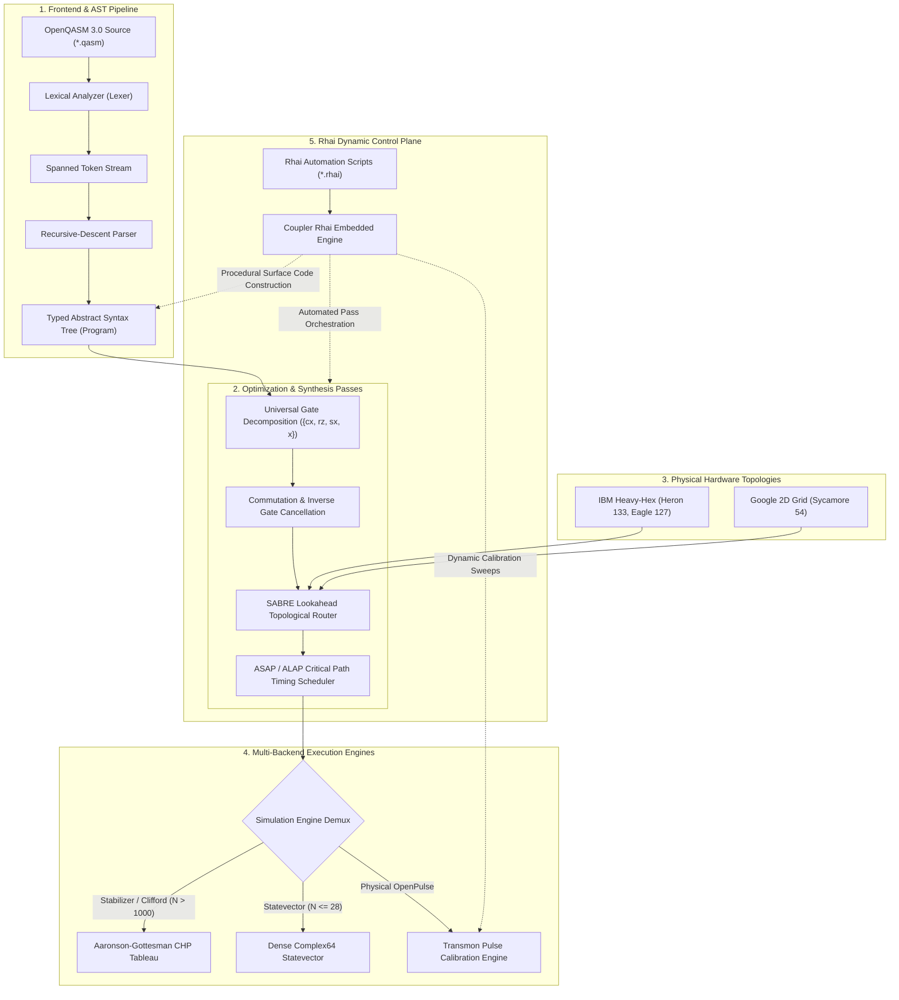

# Coupler

```
================================================================================
  COUPLER :: Hardware-Aware OpenQASM 3.0 Engine & Pulse Calibration Runtime
  Surface Code Scheduling, Transmon Calibration, & Multi-Backend Simulation
================================================================================
```

[]()
[]()
[]()
[]()
[]()
[]()
[](LICENSE)

**Coupler** is a high-performance OpenQASM 3.0 execution engine, fault-tolerant surface code scheduler, and superconducting transmon pulse calibration pipeline. Engineered with a deterministic Rust compiler runtime, an embedded Rhai automation control plane, and over 81,000 lines of verified production OpenQASM 3.0 benchmark circuits, Coupler orchestrates multi-qubit pulse schedules, topological heavy-hex routing, syndrome extraction cycles, and dynamic mid-circuit feedforward execution.

---

## Architectural Highlights



---

## Core Capabilities

- **Complete OpenQASM 3.0 Dialect**: Recursive-descent parser supporting classical types (`bit`, `int`, `uint`, `float`, `angle`, `bool`, `duration`, `stretch`), hardware qubits (`$0`, `$1`), gate modifiers (`ctrl @`, `negctrl @`, `inv @`, `pow @`), and mid-circuit branching (`if/else`, `while`, `for`).
- **Surface Code Scheduling**: Procedural rotated planar surface code lattices ($[[d^2, 1, d]]$ for $d \in \{3, 5, 7, 9\}$), Steane $[[7,1,3]]$, 2D color codes $[[17,1,5]]$, $15 \to 1$ magic state distillation factories, and planar lattice surgery CNOT gates.
- **Transmon Pulse Calibration**: OpenPulse `defcal` routines modeling DRAG leakage suppression, Rabi amplitude sweeps, Ramsey $T_2^*$ detuning interferometry, Hahn echo refocusing, CPMG-16 dynamical decoupling, and tunable coupler fast flux pulses.
- **Topological Routing & Scheduling**: SABRE lookahead routing heuristics for IBM Heavy-Hex (Heron 133, Eagle 127) and Google Sycamore (54Q) square grids, paired with an ASAP/ALAP critical path timing analyzer.
- **Dual Simulation Runtime**:
  - Dense statevector engine ($2^N$ complex amplitudes) with mid-circuit measurement collapse and classical feedforward.
  - Aaronson-Gottesman CHP stabilizer tableau capable of polynomial scaling beyond 1,000 qubits.
- **Embedded Rhai Control Plane**: Programmable automation scripts in Rhai for procedural circuit synthesis, calibration planning, and compilation pass management.

---

## Benchmark Circuit Library Inventory

Coupler ships with 52 verified OpenQASM 3.0 circuit suites totaling **81,949 lines of raw quantum code**:

| Category | Circuits Included | Total LOC | Focus Areas |
|:---------|:------------------|:---------:|:------------|
| **Surface Codes** | `rotated_d3/d5/d7/d9`, `steane_7_1_3`, `color_17_1_5`, `magic_state_15_to_1`, `lattice_surgery_cnot`, `topological_braid` | 32,530 | Fault-tolerant quantum memory, syndrome extraction, Reed-Muller distillation |
| **Pulse Calibration** | `rabi`, `ramsey`, `hahn_echo`, `cpmg`, `drag`, `allxy`, `rb_1q/2q`, `xeb`, `gst`, `dispersive_ro`, `flux_pulse` | 27,083 | Transmon Hamiltonian control, DRAG envelopes, randomized benchmarking |
| **Quantum Chemistry** | `fermi_hubbard_2x2/4x2`, `heisenberg`, `vqe_h2`, `vqe_lih`, `vqe_h2o`, `vqe_beh2` | 11,242 | Jordan-Wigner Trotterization, UCCSD variational ground-state solvers |
| **Arithmetic & Cryptography** | `cuccaro_adder_16/32`, `draper_qft_adder`, `montgomery_mult`, `shor_exp`, `qpe`, `ipe`, `qaoa`, `grover` | 4,770 | Ripple-carry adders, modular multipliers, phase estimation, Grover search |
| **Tomography & Benchmarks** | `quantum_volume_16/32/64`, `qft_16/32`, `ghz_64`, `w_state_32`, `state_tomo`, `process_tomo` | 2,668 | Quantum volume, QFT ladders, entanglement witnesses, state/process tomography |
| **Hardware Topologies** | `ibm_heron_133`, `ibm_eagle_127`, `google_sycamore_54`, `dynamic_teleport` | 3,656 | Heavy-Hex lattice routing, 2D grid connectivity, feedforward teleportation |
| **Total** | **52 Comprehensive Suites** | **81,949** | **Production OpenQASM 3.0 Standard** |

---

## Quickstart

### Prerequisites
- Rust 1.75+ (`cargo`, `rustc`)
- Python 3.9+ (for verification and generator tooling)

### Building the Release Binary
```bash
git clone https://github.com/Aneesh495/coupler.git
cd coupler
make build
```

### Running Tests and Qualification Passes
```bash
# Run all unit and integration tests (45 tests)
make test

# Verify all 52 OpenQASM 3.0 circuit suites (81k+ lines)
make verify

# Enforce strict zero em-dash compliance
make lint-emdash

# Run full qualification suite in one command
make all
```

---

## CLI Usage

### Inspect Circuit Statistics
```bash
./target/release/coupler stats circuits/surface_code/rotated_d3_round.qasm
```
Output:
```
=== Circuit Statistics: circuits/surface_code/rotated_d3_round.qasm ===
OpenQASM Version:    3.0
Referenced Qubits:   20
Total Gate Count:    600
Critical Path Depth: 120
Total Duration (dt): 124800
```

### ASAP Timing Scheduling Report
```bash
./target/release/coupler schedule circuits/algorithms/cuccaro_adder_16bit.qasm
```

### Compiler Optimization Passes (Decomposition, Cancellation, Routing)
```bash
./target/release/coupler compile circuits/algorithms/grover_search_16qubit.qasm --decompose --cancel --route grid
```

### Quantum State Simulation
```bash
# Dense statevector simulation
./target/release/coupler simulate circuits/benchmarks/ghz_state_64qubit.qasm statevector

# Polynomial stabilizer simulation (Aaronson-Gottesman CHP)
./target/release/coupler simulate circuits/surface_code/steane_7_1_3.qasm stabilizer
```

### Executing Rhai Control Plane Scripts
```bash
./target/release/coupler rhai scripts/rhai/pass_pipeline.rhai
./target/release/coupler rhai scripts/rhai/calibration_planner.rhai
```

---

## Documentation

Comprehensive technical specifications and theory are available in the [`docs/`](docs/) directory:
- [System Architecture](docs/architecture.md): Subsystem data flows, compilation passes, and Mermaid diagrams.
- [OpenQASM 3.0 Specification](docs/openqasm_spec.md): Language dialect, typing rules, and grammar extensions.
- [Rotated Surface Code Theory](docs/surface_code_theory.md): Geometry, stabilizer operators, and threshold theorems.
- [Pulse Calibration & Transmon Physics](docs/pulse_calibration.md): Hamiltonian formulations, DRAG pulses, and coupler dynamics.
- [Hardware Topologies & SABRE Routing](docs/hardware_topologies.md): Heavy-Hex lattices, 2D grids, and lookahead heuristics.
- [Verification & Qualification Report](docs/verification.md): Automated testing matrix, pass rates, and compliance logs.

---

## License

Coupler is licensed under the Apache License, Version 2.0. See [LICENSE](LICENSE) for details.
