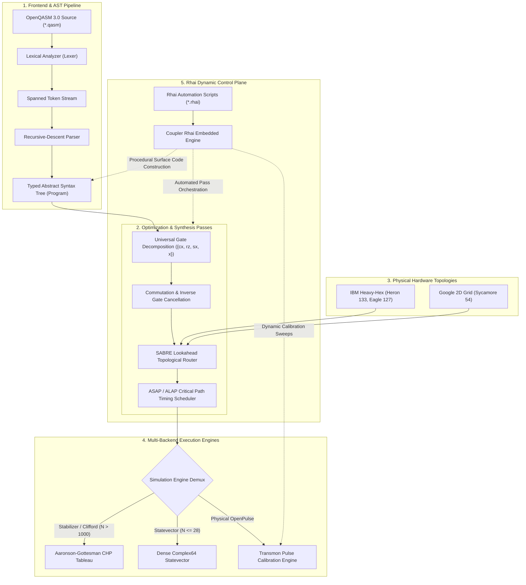

# Coupler System Architecture

Coupler is a hardware-aware OpenQASM 3.0 compilation engine, fault-tolerant surface code execution runtime, and transmon pulse calibration pipeline.

## Subsystem Details

### 1. Lexical Analysis and Parsing
The lexical analyzer scans OpenQASM 3.0 source tokens with precise line and column span tracking. It supports:
- OpenQASM 3.0 language constructs: `qubit`, `bit`, `int`, `uint`, `float`, `angle`, `bool`, `duration`, `stretch`
- Timing and physical literals: `160dt`, `25ns`, `100us`, `5ms`, `2s`
- Hardware qubit identifiers: `$0`, `$12`
- Gate modifiers: `ctrl @`, `negctrl @`, `inv @`, `pow(n) @`
- Real-time classical control flow: `if/else`, `while`, `for ... in [...]`
- Pulse calibration directives: `defcal`, `defcalgrammar "openpulse"`, `cal { ... }`

### 2. Intermediate Representation (AST)
The Abstract Syntax Tree cleanly decouples classical and quantum semantics. Qubits are addressed as single variables, registers, variable-indexed expressions (e.g., `q[i]`), or direct physical hardware channels (`$0`).

### 3. Optimization and Routing Passes
- **Gate Decomposition**: Expands arbitrary unitaries and composite gates (e.g., `swap`, `cz`, `h`, `u3`) into the native superconducting transmon basis `{cx, rz, sx, x}`.
- **Commutation and Cancellation**: Analyzes adjacent gate pairs to cancel self-inverse operations ($H^2 = I$, $X^2 = I$, $CX^2 = I$) and merges collinear rotation angles.
- **SABRE Topological Routing**: Maps logical quantum circuits onto restricted hardware connectivity graphs (IBM Heavy-Hex, 2D Grid) using shortest-path BFS/Dijkstra distance heuristics with dynamic SWAP insertion.
- **Critical Path Scheduling**: Computes As-Soon-As-Possible (ASAP) and As-Late-As-Possible (ALAP) timing allocations assuming calibrated transmon gate durations (160 dt for single-qubit gates, 800 dt for two-qubit coupler gates, 2400 dt for dispersive readout).

### 4. Dual Simulation Engines
- **Dense Statevector ($2^N$ Complex Amplitudes)**: High-precision wavefunction simulator executing unitary gates, projective measurements with collapse, and real-time classical conditional branches.
- **Aaronson-Gottesman CHP Stabilizer Tableau**: Polynomial-time stabilizer state engine capable of simulating 1,000+ qubits for surface code syndrome extraction rounds and topological quantum error correction.

### 5. Rhai Dynamic Control Plane
An embedded Rhai scripting runtime allows engineers to write lightweight automation scripts that procedurally generate circuits, orchestrate multi-pass optimization pipelines, and schedule automated pulse calibration sweeps.
